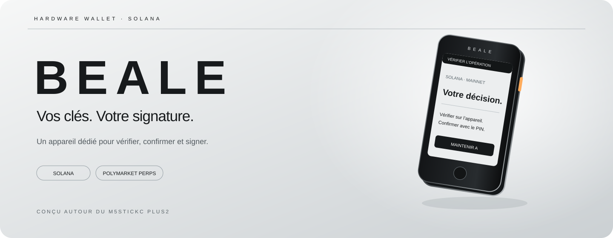
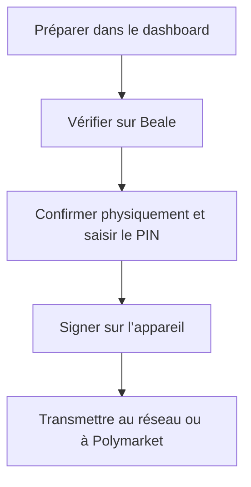

### Un appareil dédié. Une décision qui vous appartient.

Un wallet Solana sur **M5StickC Plus2**, un dashboard web et des confirmations physiques pour vos opérations.

[**Découvrir Beale ↗**](https://beale.pro) · [**Ouvrir le dashboard ↗**](https://app.beale.pro) · [**Installer une mise à jour**](docs/INSTALLATION.md)

---

## Beale, en quelques mots

Beale sépare la préparation d’une opération de sa signature. Le navigateur affiche vos comptes, prépare les transactions et communique avec les réseaux. Le M5Stick affiche les informations à vérifier, demande votre confirmation et votre PIN, puis signe les opérations prises en charge.

**Le dashboard prépare. L’appareil vous laisse décider.**

Ce dépôt présente le projet et distribue ses firmwares. **Le code source n’est pas publié dans ce dépôt.** Les fichiers d’installation sont disponibles dans l’onglet **Releases** de GitHub.

> Beale est un projet matériel et logiciel en développement. Il n’est pas présenté comme un produit certifié ou ayant fait l’objet d’un audit de sécurité indépendant.

## L’expérience Beale

| Système | Ce que vous pouvez faire |
| :--- | :--- |
| **Wallet Solana** | Consulter votre adresse et votre solde, recevoir du SOL et préparer un transfert. |
| **Mainnet / Devnet** | Utiliser le réseau réel ou tester avec des SOL Devnet sans valeur monétaire. Les adresses affichées peuvent être différentes : vérifiez toujours le réseau et l’adresse. |
| **Jetons SPL** | Consulter les jetons exposés par le dashboard ; leur affichage ne signifie pas que toutes les opérations SPL sont prises en charge. |
| **Staking** | Préparer les opérations de staking proposées par le dashboard et les vérifier sur l’appareil. |
| **Polymarket Perps** | Lier un compte existant, consulter les marchés, gérer les ordres, le levier et les positions. |
| **Personnalisation** | Modifier l’apparence de l’accueil, son fond et son thème ; synchroniser l’aperçu du dashboard. |
| **Recovery USB** | Recevoir une application signée compatible sans utiliser le parcours d’installation initiale. |

## Comment une opération est signée

Une confirmation dans le navigateur ne remplace pas la vérification sur le M5Stick. Comparez les informations affichées avant de confirmer. Pour Polymarket, une signature et un ordre accepté ne garantissent pas une exécution : consultez les ordres et les positions après l’envoi.

## Solana

La clé de signature Solana est conservée sur l’appareil. Le dashboard utilise l’adresse publique pour interroger le réseau : solde, activité et informations de compte. Les transferts pris en charge sont examinés par le firmware avant signature ; Beale ne doit pas être considéré comme un signataire universel pour toutes les applications Solana.

**Mainnet** utilise des fonds réels. **Devnet** sert aux essais. Ne déduisez jamais une adresse Mainnet à partir d’une adresse Devnet : relevez l’adresse du réseau sélectionné et vérifiez-la sur l’appareil avant tout dépôt.

La page de sauvegarde de la clé privée est accessible localement avec le PIN. Cette sauvegarde donne accès aux fonds : elle doit rester hors ligne et ne doit jamais être jointe à une issue GitHub ou envoyée au support.

## Polymarket Perps

Beale intègre les **contrats perpétuels** de Polymarket. Il ne s’agit pas des parts Oui/Non des marchés de prédiction, ni de la détention d’actions au comptant. Le graphique représente le contrat sélectionné sur Polymarket.

### Une liaison, puis une reprise sur l’appareil

1. Votre wallet propriétaire Ethereum autorise une clé de trading déléguée pour votre compte Perps, sur Polygon.
2. Beale conserve cette clé et les identifiants de session dans son stockage NVS chiffré, avec le profil protégé.
3. Lors d’une reprise, une confirmation et le PIN sur le M5Stick permettent au dashboard de récupérer la session et d’en vérifier la validité auprès de Polymarket.
4. L’autorisation est renouvelable et limitée à **sept jours**. À expiration, une nouvelle autorisation du wallet propriétaire est nécessaire.

La clé privée déléguée signe sur le M5Stick. Les identifiants de lecture sont utilisés en mémoire par le navigateur durant la session ; ils ne sont pas persistés dans son stockage local par Beale. Les identifiants publics de suivi d’ordres peuvent y être conservés.

### Ordres, positions et PnL

| Fonction | Comportement |
| :--- | :--- |
| **Limit GTC** | L’ordre peut rester ouvert jusqu’à son exécution ou son annulation. |
| **IOC** | Exécute immédiatement ce qui est disponible dans la limite du prix, puis annule le reste. |
| **FOK** | Exige une exécution immédiate de toute la quantité, sinon l’ordre est annulé. |
| **Post-only** | Pour les ordres GTC : empêche une exécution immédiate prenant la liquidité. |
| **Réduction seule** | Empêche l’ordre d’augmenter l’exposition. |
| **Clôturer** | Prépare un ordre IOC opposé, réduction seule, à vérifier et confirmer ; une clôture partielle reste possible. |
| **Levier et marge** | Réglages suivant les limites du marché ; confirmation et PIN sur l’appareil. |

Les données du compte sont actualisées toutes les **deux secondes** et les graphiques toutes les **cinq secondes**, lorsque la connexion et les API le permettent. La page Polymarket du M5Stick affiche la valeur du compte, le PnL non réalisé total et jusqu’à huit positions consultables. Le total du PnL inclut toutes les positions. Ces données d’affichage restent indicatives et sont signalées anciennes après dix secondes sans synchronisation.

**Déconnecter** révoque le proxy concerné, puis efface la liaison sur Beale après confirmation et PIN. Cela ne clôture pas vos positions et ne supprime pas vos clés Solana. Vous pouvez ensuite lier le même compte ou un autre.

Le firmware n’expose pas de fonction de retrait Polymarket ni de signature de hash arbitraire. L’accès au service et aux marchés dépend des conditions et restrictions de Polymarket.

## La sécurité, couche par couche

Ces protections concernent le **profil matériel protégé correctement provisionné**. Le nom d’un fichier firmware ne prouve pas, à lui seul, l’état de sécurité d’un appareil.

| Couche | Rôle | Limite à connaître |
| :--- | :--- | :--- |
| **Secure Boot V2** | Vérifie que le firmware démarré est signé par une clé de confiance de l’appareil. | Un firmware signé peut toujours contenir un défaut ; la signature établit sa provenance. |
| **Chiffrement de flash Release** | Protège la confidentialité des données stockées en flash avec une clé liée à l’appareil. | Ce n’est pas une garantie contre toutes les attaques physiques ou logicielles. |
| **Chiffrement NVS** | Chiffre le stockage persistant utilisé pour les données sensibles. | Les protections doivent réellement être activées sur le matériel. |
| **Contrôles au démarrage** | Vérifie les protections requises avant d’accéder au wallet dans le profil protégé. | Le contrôle ne remplace pas le provisionnement initial. |
| **Confirmation physique et PIN** | Demande une validation locale pour les opérations sensibles. | Vérifiez les données affichées ; gardez le PIN et les sauvegardes privés. |
| **Mises à jour signées** | Valide l’application reçue avant de la sélectionner au démarrage. | Seule une image compatible avec la clé de confiance peut être acceptée. |
| **Vérification côté dashboard** | Contrôle les signatures Polymarket et leur correspondance avec l’opération demandée. | Le navigateur et le site restent des éléments à protéger. |

Le M5Stick utilise les mécanismes de sécurité de son ESP32. Beale ne revendique pas de **Secure Element dédié**. Pour les détails et le signalement d’un problème, consultez [la politique de sécurité](SECURITY.md).

## L’appareil

**Matériel ciblé : M5StickC Plus2**, ESP32-PICO-V3-02 révision 3.x, flash de 8 Mo, écran 135 × 240 pixels. Ne supposez pas la compatibilité avec les autres variantes M5Stick.

| Commande | Utilisation |
| :--- | :--- |
| **A, sur l’accueil** | Parcourir les pages. |
| **B** | Action indiquée sur la page : réseau, Bluetooth, positions ou autre commande contextuelle. |
| **Maintenir A, en vérification** | Confirmer l’opération affichée. |
| **B, en vérification** | Annuler. |
| **Maintenir B au démarrage** | Accéder au mode **BEALE RECOVERY / Mise à jour USB** sur un firmware compatible. |

Les pages regroupent l’accueil, la réception, les informations de l’appareil, le Bluetooth, la sauvegarde locale et Polymarket. Le dashboard utilise l’USB dans un navigateur compatible Web Serial ; la disponibilité du Bluetooth dépend du navigateur et de la plateforme. **Polymarket et les mises à jour protégées utilisent l’USB.**

## Firmwares

### Version 3.3

Les confirmations Polymarket adaptent la taille des textes à la largeur de l’écran. Les identifiants longs sont répartis sur plusieurs lignes ; les libellés IOC/FOK sont plus explicites.

**[Guide d’installation et de mise à jour →](docs/INSTALLATION.md)** · **[Notes de version →](docs/CHANGELOG.md)**

Téléchargez les fichiers depuis l’onglet **Releases** de ce dépôt. Les versions doivent préciser leur matériel cible, leur profil, leur compatibilité et leur empreinte SHA-256. Les binaires restent dans les Releases, pas dans l’historique principal du dépôt.

> **Un appareil vierge et un appareil protégé ne s’installent pas de la même manière.** Le binaire applicatif signé 3.3 est destiné au parcours Recovery d’un appareil déjà provisionné et compatible. Il ne constitue pas un kit universel de première installation.

## Questions fréquentes

<strong>Mes fonds sont-ils dans le M5Stick ?</strong>

Les fonds Solana sont inscrits sur la blockchain. Le M5Stick conserve la clé qui permet de les contrôler. Le compte Polymarket conserve son propre solde et ses positions ; une clé déléguée permet à Beale de signer les opérations prises en charge.

<strong>Le PnL est-il calculé par le M5Stick ?</strong>

Le dashboard lit les informations Polymarket et les synchronise vers l’appareil. Ce sont des données d’affichage, distinctes du contrôle d’une opération à signer. Elles nécessitent une connexion active pour rester récentes.

<strong>Puis-je installer n’importe quel firmware signé ?</strong>

Non. Il doit correspondre au matériel, au partitionnement et à la clé de confiance inscrite dans l’appareil. La compilation et la signature ne rendent pas une image universelle.

<strong>Une déconnexion ferme-t-elle mes positions ?</strong>

Non. Déconnecter le câble, fermer le dashboard ou délier le compte ne clôture pas une position. Vérifiez séparément les positions et les ordres sur Polymarket.

<strong>Où est le code source ?</strong>

Il n’est pas distribué dans ce dépôt. Ce dépôt contient la présentation, la documentation et les informations des versions ; les firmwares compilés sont distribués via GitHub Releases. La disponibilité d’un binaire ne constitue pas une licence de redistribution ou de modification.

---

**BEALE**

Votre signature commence sur votre appareil.

[beale.pro](https://beale.pro) · [Dashboard](https://app.beale.pro)

Projet indépendant. Beale n’est pas présenté comme un produit officiel de M5Stack, Solana ou Polymarket.

